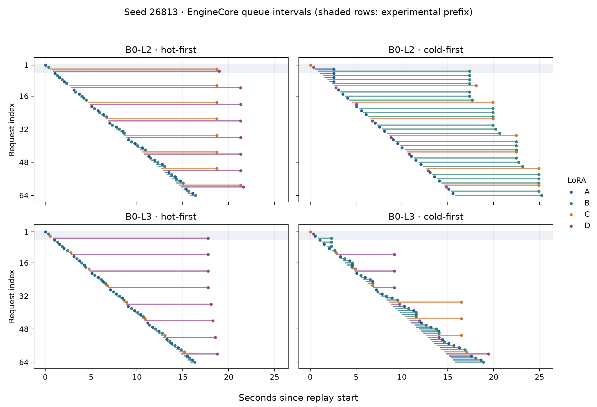

# vLLM 多 LoRA 准入阻塞与尾延迟

当多个 LoRA 共用一个 vLLM 服务时，`max_loras` 限制同时活跃的适配器种类。已有种类可以继续接收请求，暂未活跃的种类则可能长时间等待。本项目为 vLLM v0.33.0 的 V1 调度器加了按请求记录的观测，比较了准入策略、种类容量与到达顺序对尾延迟和 Goodput 的影响。

## 主要发现

| 实验 | 观察结果 |
|---|---|
| **复现阻塞** | 两名额下，固定轨迹三次复现 C 的 LoRA 上限跳过与长等待。四名额诊断组的 C 跳过次数降到零。[基线报告](docs/g1-baseline.md) |
| **策略与容量** | B2 在专门设计的竞争轨迹中兑现了 9 次交接，冷门合并 P95 的配对中位降幅为 5.7%。原版 B0 从两名额增至三名额后，三种或四种 LoRA 持续流量的九个配对都提高了 Goodput，启动 KV 容量少 96 token。[交接实验](docs/g3-competition.md) · [容量边界](docs/g3-capacity-boundary.md) |
| **短前缀消融** | 只将最初四条 LoRA 从 `ABCD` 改为 `CDAB`，后续 60 条逐条相同。在六个固定容量配对中，后缀热门排队 P95 均增加、冷门 P95 均下降。[消融设计与逐种子结果](docs/g3-prefix-order.md) |

下图使用短前缀实验的 seed 26813。每条线从服务端入队画到实际准入，灰色是改动的前四条。灰色以下两列的请求计划逐条相同，可以横向比较同一个索引的等待。



## 复现

**CPU 离线复核。** 下载并解压独立归档，在解压目录用标准库运行下面命令。输出应包含七组归档、111 轮、4,032 条归档请求及 49 张匹配的统计表。已有原始目录时，也可在项目根目录运行同一条命令。 [下载离线证据包](https://github.com/kuleeyoung/vllm-multi-lora-admission/releases/download/v0.1.0/vllm-multi-lora-g3-audit-share.zip) · [离线归档说明](docs/g3-audit-bundle.md)

```text
python -E -S -m bench.audit_g3 results/g3
```

**单卡 GPU 复跑。** 在项目根目录执行下列命令。它创建新的 Linux 工作目录，安装锁定依赖、准备固定 revision 的模型、生成 LoRA，然后用 seed 26813 运行两种前缀和两档容量，共四轮。已验证环境为 WSL2、Python 3.12、RTX 5070、CUDA 13.0 runtime 与 vLLM v0.33.0。GPU 可用性和环境细节见 [复现说明](docs/reproduce.md)。

```bash
LORA_PORT=8021 bash scripts/replay_prefix_clean.sh \
  "$HOME/work/vllm-lora-prefix-replay" results/g3/prefix-clean-replay
```

**开发回归。** 单元测试和离线分析使用 Python 标准库。绘图需要 Matplotlib。

```text
python -m unittest discover -s tests -v
```

## 代码和证据入口

- [调度补丁](patches/README.md)说明如何构建与版本锁对应的调度副本，以及 B0 原版、B1 排空、B2 定向交接与 B3 策略的实现位置。
- [设计与指标](docs/design.md)说明准入、排空、TTFT、TPOT 和 Goodput 的口径。主指标使用 EngineCore 的首次准入时间减入队时间。
- [正式评估](docs/g3-evaluation.md)、[策略选型](docs/g3-strategy-decision.md)和 [完整顺序消融](docs/g3-arrival-order.md)分别记录配对实验和各自的结论边界。
- [服务启动与回退](docs/serving-option-a.md)采用三名额 B0，保留两名额 B0。B1/B2/B3 用作实验对照。 [三分钟讲解](docs/talk-3min.md)可直接配合上图讲述。

实验使用单卡、Qwen3-0.6B BF16 与四个 rank 8 合成 LoRA。图中的排队变化适用于实验负载，复跑用于核对趋势与机制。 [项目计划](docs/project-plan.md) · [开发记录](docs/progress.md)

项目源码采用 [MIT 许可证](LICENSE)。上游依赖和模型沿用各自的许可证。 [依赖与来源说明](docs/release-review.md)
