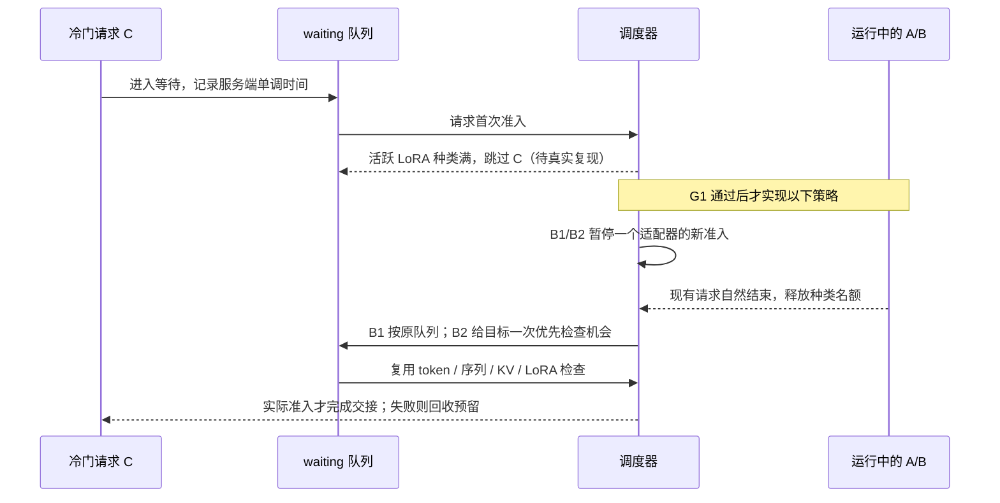

# 设计与验收边界

设计依据为 2026-11-17 的 v0.1 项目开发计划书，原文保存在 [项目开发计划](project-plan.md)。

目标是在单卡、单实例、同一个 BF16 模型和四个同 rank LoRA 下，验证适配器种类准入限制及排空后定向交接的效果。保留原有 KV Cache、LoRA 算子和运行中请求的执行规则。

B0 保留上游顺序；B1 与 B2 使用相同触发条件和排空对象选择规则。等待超过阈值、目标适配器不活跃且种类满时，选最早等待请求；排空在途数最少的活跃适配器，固定顺序打破平局。最多一个待交接记录，包含目标请求、目标适配器、排空适配器、触发和截止时间。取消、过期、目标无法准入时释放预留；加入短冷却防止反复锁住同一对象。不得额外抢占在途请求。

G0 已确认原版服务及适配器绑定，G1 已完成原版阻塞复现。运行配置和复现结果分别见 `configs/g0.json` 和 `docs/g1-baseline.md`。G2 排空与交接的实现和复跑方式见 `docs/g2-policy.md`。

G0 需要：WSL GPU 可见；独立 Python 环境的小算子通过；BF16 原版单请求；A/B/C/D 独立和交错流式响应；通过可区分效果或受控数值参考确认适配器绑定；锁定运行 commit、wheel、torch、模型 revision，核对 worker 实际导入路径。HTTP 返回成功不足以验收绑定。

G1 需要：至少三个固定轨迹，服务端首次等待、LoRA 上限跳过、热门适配器继续运行/补入、冷门最终结局的完整事件链。低负载和 `max_loras=4` 是归因诊断。必须与 token/KV/并发限制区分。

G2 需要：取消、过期、无空余名额、多个候选、token/KV 限制、B0 回退及不变量回归。G3 在不同调参与正式评估种子下配对运行 B0/B1/B2，主要比较 B2 对 B1。预案目标为冷门排队 P95 下降至少 20%、Goodput 降幅不超过 5%，当前没有性能实测。

客户端 TTFT（发出至首 token）不能代替服务端排队时间（收到至首次有效调度）。SSE 文本块不能当作 token 数。失败、超时、未准入单列；正式负载使用开环到达，并保留实际发送滞后、轨迹哈希及逐请求原始数据。

已有工作与来源见原计划书；本项目的工程假设和研究新颖性均待验证。
