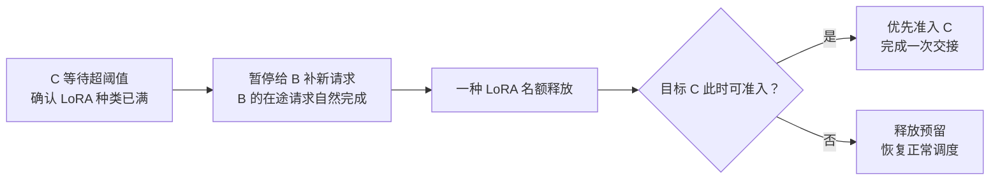

# vLLM 多 LoRA 准入调度与尾延迟优化 · 项目开发计划书

**版本** v0.1 ｜ **日期** 2026-11-17 ｜ **状态** 立项，待复现基线

**项目目标**：在单张 RTX 5070 上复现 vLLM 多 LoRA 服务的适配器准入阻塞，评估「排空后定向交接名额」能否减少冷门适配器的长等待，并量化对其他请求、合批和吞吐的影响。

| 已核对 | 仍待验证 |
|---|---|
| 本机 Windows 识别 1 张 RTX 5070，显存 12,227 MiB，驱动 610.88，存在 Ubuntu 24.04 WSL2 发行版。vLLM v0.33.0 源码包含 LoRA 种类上限检查。 | WSL 内 GPU 和选定 wheel 是否可用，真实压测能否稳定复现阻塞，结构化事件开销，以及定向交接的实际收益。 |

本次交付是开发计划书。仓库、环境安装、模型下载、训练与压测均属于后续实施。

## 1. 问题、已有工作与项目边界

一台 vLLM 服务承载一个 BF16 基础模型和多个 LoRA 适配器。设 `max_loras=2`，正在运行的请求使用 A、B，冷门适配器 C 在队列里等待。A、B 的已有请求虽会结束，同类新请求却可能在最后一个旧请求结束前不断补入，使两个适配器种类都持续占用准入名额。C 即使排在最前面，也可能因为无法满足种类上限而多次被跳过。这里的名额指调度器里的**活跃适配器种类额度**，与某个物理显存地址或增加 GPU 容量是不同概念。[vLLM v0.33.0 调度源代码](https://github.com/vllm-project/vllm/blob/v0.33.0/vllm/v1/core/sched/scheduler.py)

SGLang 已有按等待时间触发的 `LoRADrainer`，其文档明确说明排空完成的名额采用尽力而为的分配方式，未为触发者预留。Chameleon 已研究适配器感知的非抢占式调度，VTC 已研究基于 token 成本的服务公平性。项目拟验证的增量是：**在可复现的 vLLM 准入冲突中，先让一个活跃适配器自然退出，再把释放的机会定向交给等待目标，比较它相对仅排空的效果。** 这是一项待验证的工程假设，研究新颖性需要独立检索和比较。[SGLang LoRA 文档](https://github.com/sgl-project/sglang/blob/main/docs/docs/advanced_features/lora.mdx) · [Chameleon](https://arxiv.org/abs/2411.17741) · [VTC](https://www.usenix.org/conference/osdi24/presentation/sheng)

项目独立于 NestQuant-AIInfra。NestQuant 提供低比特执行与单卡引擎证据，本项目提供**改主流引擎调度源码、定位适配器级队列问题、用真实服务 A/B 验证策略**的证据。第一版固定单卡、单实例、一个基础模型、同 rank LoRA 和原有 KV Cache／LoRA 算子。多 GPU、训练适配器效果、异步预取、新 CUDA kernel 和模型路由留作后续选题。

## 2. 最小实现

**环境**：在现有 WSL2 发行版内使用独立 Python 环境和独立源码目录，例如 `~/work/vllm-lora-admission`，报告可复制到 Windows 项目目录。候选上游版本为 `v0.33.0`，发布页标明该版 wheel 使用 CUDA 13.0。先验证 WSL 内 `nvidia-smi`、PyTorch GPU 小算子、vLLM BF16 单请求和多 LoRA 流式请求，再把通过的 tag、完整 commit、wheel、PyTorch 和模型 revision 锁入 manifest。若候选版本不兼容，换可运行的已发布版本并重新核对准入检查。Python 调度改动优先按对应版本文档使用匹配的预编译扩展。确认运行 worker 实际加载了修改后的源码，并保留上游基线环境或等价的回滚入口。[vLLM v0.33.0 发布页](https://github.com/vllm-project/vllm/releases/tag/v0.33.0) · [vLLM 安装与 Python 开发模式](https://docs.vllm.ai/en/stable/getting_started/installation/gpu/)

**负载起点**：Qwen3-0.6B BF16，4 个同 rank、同 target modules 的 LoRA（A/B/C/D），`max_loras=2`，CPU 缓存足以容纳全部实验适配器（按所选版本核对 `max_cpu_loras`）。先用短上下文和有限输出，逐步加长至能够稳定保持 A/B 在途的负载。若缺少可用权重，可用固定种子生成格式兼容、数值有限且有可区分效果的合成适配器，仅供正确性和性能测试。支持一个基础模型加多个已注册适配器，测试请求显式指定适配器 ID。[Qwen3-0.6B 模型卡](https://huggingface.co/Qwen/Qwen3-0.6B) · [vLLM LoRA 文档](https://docs.vllm.ai/en/stable/features/lora/)

| 组别 | 做什么 | 问题 |
|---|---|---|
| B0 原版 | 保留上游准入规则和队列顺序，加入等价的观测 | 阻塞能否复现，是否主要由适配器种类限制导致？ |
| B1 仅排空 | 等待阈值触发后，暂停选中适配器的新请求准入。现有请求自然结束，名额按原队列规则分配 | 排空本身能减少多少等待？ |
| B2 排空加交接 | 沿用 B1 的触发条件与排空对象选择规则。名额释放后，给触发排空且仍符合条件的目标一次优先准入机会 | 定向交接带来多少增量收益和代价？ |

**策略细节**

1. 以服务端单调时钟记录首次进入 waiting 的时间。只在请求等待超过阈值、目标适配器尚未活跃、活跃种类已满时考虑触发。第一版选择最早等待的候选，排空对象按当前在途请求数最少并用固定顺序处理平局。
2. 同时最多维护一个待交接记录，包含目标请求和适配器、排空适配器、触发时间及期限。排空只暂停目标移出适配器的**新准入**，已运行请求照常执行。B1/B2 都不得为该策略额外抢占正在生成的请求。
3. 名额自然释放后，B2 把目标提到本轮可考虑的队列位置，复用 vLLM 自己的 token、序列、KV 和适配器检查。一次交接以**实际准入成功**为完成条件。请求取消、期限到达，或当前条件无法准入时清掉预留，并允许正常候选使用机会。设置有限期限、同一目标的短冷却期和状态清理，防止重复触发锁住一个适配器。
4. 保持调度不变量：活跃适配器数始终不超上限，状态跨调度轮次一致，无重复准入，无残留预留。切换到 B0 后执行原决策。等待阈值触发的是调度动作，实际等待仍受在途生成和其他资源约束。

## 3. 开发日程与验收

按 **四周、每周约 6–8 小时**估算。优先完成一条真实基线再投入策略开发，环境兼容性和基线是否存在决定后续工作量。

| 阶段 | 做什么、为什么 | 交付和通过条件 |
|---|---|---|
| 第 1 周 · G0 环境与源码 | 验证 GPU，在原版启动小模型和 LoRA，读请求如何从 waiting 进入 running，以及适配器如何关联到请求。先把工具链问题与调度问题分开。 | 环境 manifest、启动命令、四种适配器的独立请求和交错流式响应。用可区分的输出或受控数值参考校验适配器绑定。能指到锁定版本的 `max_loras` 检查和首次准入位置。 |
| 第 2 周 · G1 复现阻塞 | 用 A/B 长输出持续补流，插入稀疏 C，再加入 D 构造竞争。记录哪次调度为何跳过 C，并在可行时用提高 LoRA 上限的诊断组验证归因。 | 至少 3 次固定轨迹复现并保留一条完整事件时间线，显示 C 被 LoRA 上限跳过、A/B 能继续运行或补入，以及 C 最终准入、取消或超时。低负载或放宽上限时应能解释现象变化。阈值和主验收指标在此阶段锁定。 |
| 第 3 周 · G2 排空、交接及回归 | 先实现 B1，再加 B2；同一份代码用配置切换。通过确定性调度测试覆盖交接和回退，之后接入真实流式服务。 | 测试覆盖 A/B/C/D 竞争、自然释放、取消、过期、KV 或 token 约束、无空余名额、多个候选及 B0 回退。真实请求无混用适配器、无策略导致的丢请求或额外抢占。至少一条事件轨迹能解释有或没有交接收益。 |
| 第 4 周 · G3 正式实验与整理 | 在锁定的独立评估负载上跑三组配对实验，汇总收益、代价及无收益区间。 | 补丁、配置、回放和分析脚本、原始样本、图表与一页结论；在干净的同版本环境按 README 重放一组关键结果。保留一份 3 分钟讲解稿，用“上游行为 → 复现证据 → 改动 → 代价”讲清楚。 |

### G1/G2 决策点

- **原版很少遇到 LoRA 上限**：先核对四个适配器是否真的混跑、A/B 的在途区间是否重叠，以及是否被 KV 或请求并发限制主导。查看 `max_loras=4` 可否以可接受的显存代价解决；这组由于容量不同，属于诊断对照。若合理配置下阻塞仍无法稳定复现，这个选题先收敛为基线与诊断报告。
- **B1 已大幅降低长等待，几乎没有错失机会**：先查 B1 的队列顺序为什么已优先选择目标。若现象普遍成立，提交 B1 的工程复现和 B2 的负结果，保留较简单的默认方案。
- **B1 的名额确实可能被其他请求先用**：进入 B2 正式评估。即使 B2 压低了冷门 P95，也要查看其他适配器等待、吞吐和 GPU 批次填充情况，再决定推荐开关默认值。

## 4. 压测与证据标准

**先锁定假设。** 主要比较是 B2 对 B1。B1 对 B0 用来测排空本身。B0 与 B1/B2 使用同一 commit 基线、模型、适配器、tokenizer、GPU 配置、输出上限、缓存开关和观测配置。调参流量和正式评估流量用不同种子。记录请求 ID、适配器 ID、请求偏移、prompt、最大输出长度和轨迹哈希。使用 **Open-loop（开环）**，客户端按预设时间发请求，避免慢策略因客户端等回复而自动降低到达率。

| 轨迹 | 用途 |
|---|---|
| 均匀流量、低负载 | 验证无争用时策略几乎不触发，核对原路径行为和开销 |
| A/B 稳定高负载，C 低频 | 复现种类占用导致的长等待，量化 B1 的收益 |
| A/B 高负载，C/D 交错或热点切换 | 观察排空后名额竞争，检验 B2 的增量和其他适配器等待 |
| 短输出与长输出两档 | 确定自然排空等待何时主导结果；额外做取消与预留回收用例 |

从低负载扫到接近原版饱和和轻度过载。每个正式场景至少用 **3 个配对种子**，硬件条件允许时做 5 个。模式交错运行，使用相同预热规则，记录持续时间、每组请求数、失败/超时数及显存占用。正式性能组使用相同级别的低开销事件采样。详细逐步 trace 单独短跑，用于归因。

| 指标 | 定义与用途 |
|---|---|
| **主指标：冷门适配器排队 P95** | 首次有效调度时间减去服务端收到请求时间。按适配器分别报告，并记录从排空触发到目标首次准入的时间。 |
| P99 与长等待比例 | 作为尾部证据。冷门每种样本不足时标注样本数，把 P99 作为描述性结果；若每种每策略跨相同场景至少约 1,000 条冷门样本，再谨慎解读 P99，同时保留逐次运行结果。超时和未准入须单列，避免只统计成功请求造成偏差。 |
| 名额竞争与策略动作 | 区分被 LoRA 上限跳过、其他资源阻塞、排空触发、名额释放、目标准入、被别的适配器先占用、预留过期或取消。B1 用同一目标追踪，才能定义错失次数。 |
| TTFT、TPOT、Goodput | TTFT 为请求发出到首 token。TPOT 为首 token 之后平均每 token 耗时，单 token 请求单列。Goodput 为测量窗口内每秒完成且满足预先固定延迟目标的请求。保存实际发送时间和发包滞后。 |
| 吞吐与成本 | 请求吞吐、输出 token/s、批大小、有效 GPU 批次填充、调度耗时、峰值显存、热门请求尾延迟。与低负载基线和高负载基线分别比较。 |

**建议预注册的工程目标**：在确认 B1 存在名额竞争的工作负载上，B2 相比 B1 的冷门排队 P95 降低至少 **20%**，整体 Goodput 降幅不超过 **5%**，并检查效果是否能在独立回放中重现。**20% 和 5% 是项目验收提案，当前没有实测结果。** G1 后可据稳定基线修订并记录理由，G3 开始后锁定。正文给出配对各轮差值及中位数，以请求流或运行为比较单元；绝对毫秒和相对变化都要保留。未达门槛时也交付完整结果，说明是交接机会少、排空慢，还是让渡名额的吞吐代价过大。[vLLM 压测口径](https://docs.vllm.ai/en/latest/benchmarking/cli/) · [vLLM 服务指标](https://docs.vllm.ai/en/latest/design/metrics/)

## 5. 仓库交付与开始前两次动手

| 建议产物 | 内容 |
|---|---|
| `README.md` 与 `docs/design.md` | 一张时序图、设计与已有工作、复现步骤、使用范围、基线与负结果。 |
| `patches/` 与 `env/` | 上游 commit、调度补丁、依赖与环境版本记录、可回退运行方式。 |
| `configs/` 和 `bench/` | 负载配置、种子、开环回放、按 request ID 关联客户端与服务端事件、报告生成。 |
| `tests/` 和 `results/` | 关键调度回归；命令、原始逐请求 JSONL、聚合 CSV、时序图、尾延迟与 Goodput 对比图。 |

**第一次动手**：在独立 WSL2 Python 环境确认 GPU 可见，跑通一个 BF16 流式请求，再跑四个适配器各一条和一次短并发。保存版本和日志。模型路径与依赖版本确认后，再写正式可复制启动脚本。

**第二次动手**：维持 A、B 各有在途请求，插入 C，在服务端给 `max_loras` 跳过分支加可关联请求 ID 的计数或短 trace。一旦找到第一条完整的 C 阻塞链，画出 A/B/C 的准入时间线。带着这条证据进入 B1。

简历暂用项目题目 **「基于 vLLM 的多 LoRA 准入调度与尾延迟分析」**。正式写入简历时，用“什么负载复现了什么问题、改了哪一处、在单张 5070 上相对哪个基线测到什么、代价是多少”描述。仓库留存数据后再填入数字。
